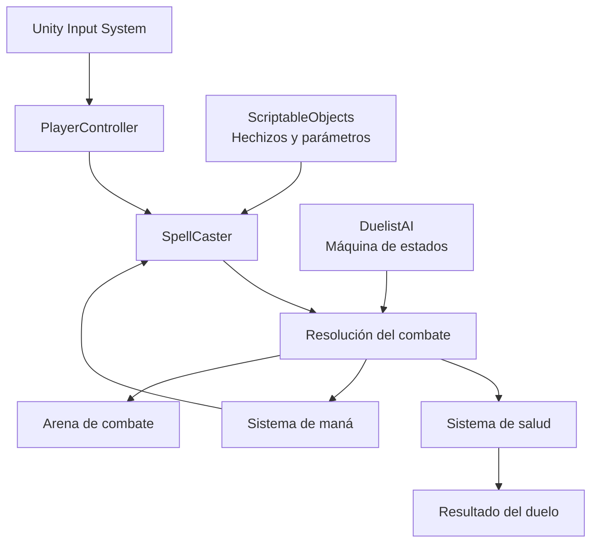

# 🪄 Mana Zone

**Lee a tu rival. Domina la magia. Gana el duelo.**

Mana Zone es un videojuego de duelos mágicos en tercera persona, desarrollado en Unity para PC. Combina combate táctico, lanzamiento de hechizos y lectura del comportamiento del oponente. La victoria depende de saber cuándo atacar, defenderse, engañar y contraatacar.

El proyecto busca recuperar la esencia de los duelos mágicos clásicos con un sistema estratégico en el que cada decisión puede cambiar el resultado del enfrentamiento.

## 🎮 Características principales

- **Combate mágico táctico:** administra tus recursos y elige cuándo atacar o defenderte.
- **Duelos en tercera persona:** controla directamente a tu duelista en una arena de combate.
- **Sistema de hechizos:** combina habilidades ofensivas, defensivas y de control.
- **Inteligencia artificial enemiga:** oponentes con patrones de ataque y respuestas a las acciones del jugador.
- **Gestión de recursos:** administra la salud y el maná durante el combate.
- **Diseño modular:** estructura preparada para ampliar los hechizos y comportamientos enemigos.
- **Progresión roguelike en exploración:** posibilidad de mejorar hechizos después de cada victoria y personalizar el estilo de combate.

## ⚔️ Filosofía de combate

El combate gira en torno a cuatro acciones:

1. **Leer:** identifica los patrones y las intenciones del rival.
2. **Provocar:** crea oportunidades para que el oponente revele sus movimientos.
3. **Engañar:** aprovecha las decisiones del enemigo para obtener una ventaja táctica.
4. **Contrarrestar:** responde al ataque adecuado en el momento justo.

Cada duelo se organiza conceptualmente en tres etapas:

| Etapa | Enfoque |
|---|---|
| 🔎 Preparación | Posicionamiento, observación y gestión de recursos. |
| 🧠 Decisión | Selección del hechizo y del momento de lanzamiento. |
| ✨ Resolución | Impacto, bloqueo, contraataque y consecuencias. |

La intención es que los enfrentamientos se sientan como un intercambio de decisiones, no como una simple sucesión de proyectiles.

## ✨ Sistema de hechizos

El prototipo contempla cuatro hechizos iniciales:

| Hechizo | Categoría | Función |
|---|---|---|
| `Rayo arcano` | Ofensivo | Inflige daño al oponente mediante un proyectil mágico. |
| `Égida` | Defensivo | Genera un escudo para proteger al duelista. |
| `Reversio` | Contrahechizo | Permite responder a las acciones mágicas del rival. |
| `Vincula` | Control | Restringe temporalmente el movimiento del enemigo. |

Los hechizos son la base del sistema de combate y podrán ampliarse con nuevas habilidades, efectos y variantes.

## 📊 Recursos del jugador

Valores iniciales de referencia para el prototipo:

| Recurso | Valor inicial |
|---|---:|
| Salud máxima | 100 |
| Maná máximo | 100 |
| Regeneración de maná | 8 unidades/s |

Cada hechizo consume maná según su coste individual. El jugador debe decidir cuándo gastar sus habilidades y cuándo reservar energía para responder a una amenaza.

Estos valores son parámetros de prototipo y pueden cambiar durante el balance del juego.

## 🕹️ Controles

Controles previstos para el prototipo:

| Entrada | Acción |
|---|---|
| `W` `A` `S` `D` | Movimiento del personaje |
| `Ratón` | Apuntar y orientar las acciones |
| `LMB` | Acción principal o lanzamiento ofensivo |
| `RMB` | Acción secundaria o defensa |
| `Q` | Hechizo asignado |
| `E` | Hechizo asignado |
| `Space` | Acción contextual o movimiento especial |

La asignación definitiva depende de la configuración de `Unity Input System` y del desarrollo de cada habilidad.

## 🤖 Inteligencia artificial

Los enemigos utilizan una arquitectura basada en estados para organizar sus decisiones de combate. Entre los comportamientos contemplados están:

- Evaluar la distancia respecto al jugador.
- Seleccionar ataques según las condiciones del combate.
- Alternar entre acciones ofensivas y defensivas.
- Respetar los tiempos de lanzamiento y recuperación.
- Crear patrones reconocibles que el jugador pueda aprender y anticipar.

El objetivo es dar a cada enemigo una identidad de combate propia, con distintos patrones, prioridades y ventanas de oportunidad.

## 🛠️ Tecnologías

| Área | Tecnología |
|---|---|
| Motor | `Unity` |
| Lenguaje | `C#` |
| Sistema de entrada | `Unity Input System` |
| Arquitectura de datos | `ScriptableObjects` |
| Física y colisiones | `Unity Physics` |
| Control de versiones | `Git` y `GitHub` |

## 🧩 Arquitectura del proyecto

La implementación busca separar responsabilidades para facilitar el mantenimiento y la incorporación de nuevas mecánicas.

| Componente | Responsabilidad |
|---|---|
| `PlayerController` | Movimiento y control del duelista. |
| `SpellCaster` | Lanzamiento y gestión de hechizos. |
| `DuelistAI` | Decisiones y comportamiento del oponente. |
| `ScriptableObjects` | Configuración de hechizos y parámetros reutilizables. |
| Sistema de salud | Administración del daño y la vida. |
| Sistema de maná | Consumo y regeneración de energía mágica. |

Los nombres representan la organización prevista de los sistemas y pueden variar según la implementación actual del proyecto.

## 🚧 Estado del desarrollo

Mana Zone se encuentra en etapa de prototipado y definición de sus sistemas principales.

- [x] Definir el concepto de combate táctico.
- [x] Diseñar las categorías iniciales de hechizos.
- [ ] Completar el controlador y el movimiento del jugador.
- [ ] Integrar el lanzamiento de proyectiles mágicos.
- [ ] Implementar costes y regeneración de maná.
- [ ] Completar el sistema de escudos y contrahechizos.
- [ ] Desarrollar patrones de comportamiento para los enemigos.
- [ ] Crear una arena de combate funcional.
- [ ] Ajustar el balance de los hechizos.
- [ ] Explorar un sistema de mejoras roguelike.

Actualiza el progreso conforme cada tarea se integre y pruebe dentro del proyecto.

## 🎯 Objetivos del prototipo

La primera versión jugable busca demostrar el núcleo de la experiencia:

1. Controlar un duelista en tercera persona.
2. Enfrentarse a un enemigo controlado por IA.
3. Lanzar hechizos con distintas funciones.
4. Gestionar salud y maná.
5. Defenderse y contrarrestar ataques.
6. Completar un duelo que recompense la lectura del rival y la toma de decisiones.

El enfoque inicial es un modo PvE para un jugador. El multijugador y los sistemas de progresión más complejos quedan fuera del alcance del prototipo inicial.

## 🔮 Visión a futuro

Entre las posibilidades de expansión se encuentran:

- Nuevos hechizos ofensivos, defensivos y de control.
- Enemigos con patrones y estilos de combate únicos.
- Mejoras de hechizos después de cada victoria.
- Sinergias entre habilidades y configuraciones de combate.
- Torneos y encuentros con dificultad progresiva.
- Nuevas arenas y efectos mágicos.

La progresión roguelike se plantea como una forma de dar variedad a cada partida sin perder el énfasis en la habilidad del jugador.

## 👨‍💻 Autoría

Proyecto personal de desarrollo de videojuegos creado con `Unity` y `C#`.

**Mana Zone** — un duelo no se gana lanzando más hechizos, sino tomando mejores decisiones.

---

*Documento de referencia del proyecto. Las características descritas como futuras, previstas o en exploración no representan necesariamente funcionalidades terminadas.*
