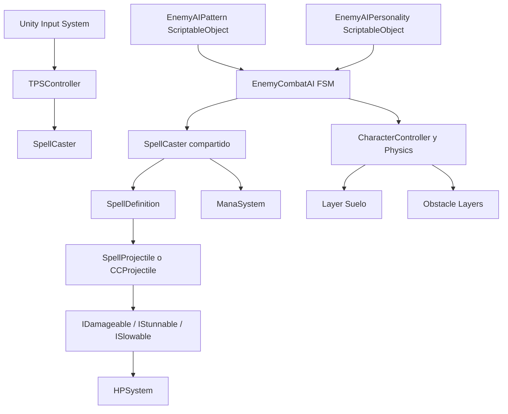

# Mana Zone

[](https://unity.com/)
[](https://learn.microsoft.com/dotnet/csharp/)
[](#estado-del-desarrollo)
[](#caracter%C3%ADsticas-principales)

**Lee a tu rival. Domina la magia. Gana el duelo.**

Mana Zone es un videojuego de duelos mágicos en tercera persona, desarrollado en Unity para PC. Combina combate táctico, lanzamiento de hechizos y lectura del comportamiento del oponente. La victoria depende de saber cuándo atacar, defenderse, engañar y contraatacar.

El proyecto busca recuperar la esencia de los duelos mágicos clásicos con un sistema estratégico en el que cada decisión puede cambiar el resultado del enfrentamiento.

## Características principales

- **Combate mágico táctico:** administra salud y maná, y elige cuándo atacar o defenderte.
- **Duelos en tercera persona:** controla directamente a tu duelista en una arena de combate.
- **Sistema de hechizos:** combina habilidades ofensivas, defensivas y de control definidas mediante ScriptableObjects.
- **IA enemiga modular:** una máquina de estados común utiliza patrones y personalidades configurables.
- **Movimiento táctico del enemigo:** aproxima, reposiciona, orbita al jugador, esquiva periódicamente y busca rutas con suelo libre de paredes.
- **Control y defensa:** el stun afecta el movimiento y el lanzamiento del jugador; Shield intercepta proyectiles y Parry puede reflejarlos.
- **Diseño modular:** permite crear nuevos hechizos, patrones y perfiles desde el Inspector sin implementar una IA separada para cada enemigo.
- **Progresión roguelike en exploración:** posibilidad futura de mejorar hechizos después de cada victoria y personalizar el estilo de combate.

## Filosofía de combate

El combate gira en torno a cuatro acciones:

1. **Leer:** identifica los patrones y las intenciones del rival.
2. **Provocar:** crea oportunidades para que el oponente revele sus movimientos.
3. **Engañar:** aprovecha las decisiones del enemigo para obtener una ventaja táctica.
4. **Contrarrestar:** responde al ataque adecuado en el momento justo.

Cada duelo se organiza conceptualmente en tres etapas:

| Etapa | Enfoque |
|---|---|
| Preparación | Posicionamiento, observación y gestión de recursos. |
| Decisión | Selección del hechizo y del momento de lanzamiento. |
| Resolución | Impacto, bloqueo, contraataque y consecuencias. |

La intención es que los enfrentamientos se sientan como un intercambio de decisiones, no como una simple sucesión de proyectiles.

## Sistema de hechizos

Los hechizos se definen con ScriptableObjects derivados de `SpellDefinition`. Cada definición conoce su coste y cooldown y ejecuta su efecto mediante `Cast(SpellCastContext)`. El `SpellCaster` comprueba recursos, crea el contexto y lanza el hechizo; la entrada del jugador y las decisiones de la IA son dos formas de solicitar el mismo lanzamiento.

| Hechizo | Categoría | Función |
|---|---|---|
| `OffensiveBolt` / Rayo arcano | Ofensivo | Crea un `SpellProjectile` que inflige daño. El asset actual cuesta 15 de maná y tiene 1 s de cooldown. |
| `ProtectiveAegis` | Defensivo | Definición de hechizo defensivo para escudo o parry según su modo y referencias. |
| `BindingBolt` / Vincula | Control | Crea un `CCProjectile`. Cuesta 20 de maná y tiene 4 s de cooldown. |

Los prefabs de proyectil implementan `ILaunchableSpell`. Los proyectiles consultan las interfaces de combate en el objeto impactado: `IDamageable`, `IStunnable` o `ISlowable`. El sistema no duplica el daño, la vida ni el maná para la IA.

Los proyectiles ofensivos atraviesan otros proyectiles sin destruirse. Las defensas mantienen un comportamiento especial: Shield destruye el proyectil interceptado y Parry lo refleja hacia su nuevo propietario.

## Recursos del jugador

Valores configurados actualmente en la escena de prueba:

| Recurso | Valor de referencia |
|---|---:|
| Salud máxima | 100 |
| Maná máximo | 100 |
| Regeneración de maná | 12 unidades/s |

Cada hechizo consume maná según su definición. Los campos de interfaz de `HPSystem` y `ManaSystem` son opcionales; un enemigo puede usar esos componentes sin barras de UI.

Estos valores son parámetros del prototipo y pueden cambiar durante el balance del juego.

## Controles

El jugador usa Unity Input System. Las asignaciones concretas dependen del asset de Input Actions configurado en la escena.

| Entrada | Acción |
|---|---|
| `W` `A` `S` `D` | Movimiento del personaje |
| Ratón | Apuntar y orientar las acciones, según la configuración de la escena |
| `LMB` | Acción principal o lanzamiento ofensivo |
| `RMB` | Acción secundaria o defensa |
| `Q` / `E` | Selección de hechizos, según el mapa de entrada |
| `Space` | Acción contextual o movimiento especial, si está configurado |

El enemigo no requiere un asset de Input Actions. Su `SpellCaster` recibe llamadas de `EnemyCombatAI` mediante `TryCastSpell`.

## Inteligencia artificial enemiga

La IA está implementada en `EnemyCombatAI`. Su comportamiento común se compone de tres partes:

1. Una máquina de estados que controla el ciclo de combate.
2. `EnemyAIPattern` ScriptableObjects que describen acciones y condiciones de ataque.
3. `EnemyAIPersonality` ScriptableObjects que cambian distancias, prioridades y movimiento.

Así se crean enemigos distintos con datos diferentes y la misma lógica de ejecución.

### Componentes y referencias

El objeto enemigo necesita un `CharacterController` y `EnemyCombatAI`. Añade o asigna también `SpellCaster`, `ManaSystem` y, si el enemigo usa el sistema de vida actual, `HPSystem`.

En el Inspector de `EnemyCombatAI`, asigna:

- `Player`: Transform del jugador. Si está vacío, la IA intenta encontrar un GameObject con tag `Player` al iniciar.
- `Personality`: el perfil ScriptableObject elegido.
- `Patterns`: patrones que el enemigo puede usar.
- `SpellCaster`, `Mana` y `Health`: si están en el mismo GameObject, se buscan automáticamente; pueden asignarse manualmente.
- `Ground Layers` y `Obstacle Layers`: capas que usa el movimiento para reconocer suelo y paredes.

En `SpellCaster`, asigna `Cast Point`, `Mana System` y los hechizos de `Equipped Spells`. El punto de lanzamiento no se busca automáticamente. Cada acción de un patrón debe referenciar un hechizo que esté equipado en ese lanzador. Esto evita que la IA use habilidades que el enemigo no tiene disponibles.

### Máquina de estados finitos

| Estado | Responsabilidad |
|---|---|
| `Idle` | Espera la siguiente evaluación y mantiene movimiento de combate. |
| `Approach` | Se acerca cuando está más lejos que la distancia preferida. |
| `Reposition` | Se aleja si está demasiado cerca. |
| `EvaluateCombat` | Revisa rango, recursos, cooldowns y patrones elegibles. |
| `PrepareAttack` | Espera preparación más reacción antes de ejecutar la primera acción. |
| `Attack` | Ejecuta una acción del patrón por turno. |
| `Defend` | Prepara y ejecuta un patrón cuya primera acción sea un `DefensiveSpellDefinition`. |
| `Recover` | Respeta la pausa entre acciones o la recuperación después de un patrón. |
| `Stunned` | Interrumpe el patrón y detiene el movimiento mientras dure el aturdimiento. |
| `Dead` | Deja de tomar decisiones cuando la vida del enemigo llega a cero. |

Primero, la IA intenta llegar a `Preferred Distance`, usando una tolerancia de una unidad. Luego elige un patrón. Mientras prepara, ataca o se recupera, se mueve lateralmente y corrige su distancia al jugador. Tras completar cierto número de patrones hace un impulso evasivo.

### Selección contextual y ponderada

La selección ponderada solo ocurre después de filtrar las condiciones obligatorias. La IA rechaza un patrón si está fuera de rango, si contiene referencias vacías, si un hechizo no está equipado, si algún hechizo está en cooldown o no se puede pagar, o si el maná actual no puede cubrir la suma de costes del patrón.

Los patrones de tipo `Counter` también requieren que un sensor llame a `ObservePlayerAttack()`. No existe aún un sensor que detecte automáticamente una acción de ataque del jugador.

Para cada patrón válido se calcula un peso base:

```text
Selection Weight × Preference(Kind)
```

Luego el peso se ajusta por contexto:

- `Harassment` recibe un multiplicador de `Aggression`.
- `Counter` recibe un multiplicador inverso de `Aggression`.
- El coste relativo de las acciones reduce el peso según `Mana Spending` y el maná máximo.
- `Low Player Health Bonus` aumenta el peso cuando el jugador con `HPSystem` tiene poca vida.

Se elige aleatoriamente entre los pesos válidos. La aleatoriedad nunca permite ignorar rango, loadout, maná ni cooldowns.

### Patrones de ataque como ScriptableObjects

Crea un patrón con **Create → Mana Zone → Enemy AI → Attack Pattern**. Los assets de ejemplo están en `Assets/EnemyAI/PatronAtaque`.

Un patrón es un asset de datos reutilizable; no es un componente ni contiene una implementación de IA propia. `EnemyCombatAI` evalúa los campos de ese asset y ejecuta sus `SpellDefinition` con el `SpellCaster` del enemigo.

| Parámetro del patrón | Qué hace y por qué influye |
|---|---|
| `Pattern Id` | Identificador legible para organizar y depurar el patrón. No cambia la selección por sí mismo. |
| `Kind` | Categoría (`Harassment`, `Charged`, `Counter`, `SpaceControl`) que consulta las preferencias de la personalidad y aplica sus reglas de peso. |
| `Actions` | Lista ordenada de assets `SpellDefinition`. La IA intenta ejecutarlos en ese orden. No se arrastran aquí los prefabs de proyectil. |
| `Min Distance` / `Max Distance` | Ventana válida de distancia. Fuera de ella el patrón se descarta antes del sorteo. |
| `Preparation Time` | Señal temporal antes del primer hechizo. Se suma a la reacción efectiva para dar tiempo de respuesta al jugador. |
| `Pause Between Actions` | Separación entre acciones de una secuencia. Debe ser compatible con los cooldowns de los hechizos. |
| `Recovery Time` | Ventana posterior al patrón. Un valor mayor separa ataques y da una oportunidad más amplia de contraatacar. |
| `Selection Weight` | Peso base frente a otros patrones elegibles. Un valor alto lo hace más probable, pero no ignora requisitos. |
| `Low Player Health Bonus` | Preferencia adicional si el jugador tiene `HPSystem` y está herido; admite valores entre 0 y 1. |

Los cooldowns se aplican a cada hechizo aunque forme parte de una secuencia. Si se repite el mismo hechizo en `Actions` antes de que termine su cooldown, esa segunda acción no estará disponible y la secuencia se interrumpirá. Para una cadena fluida, usa hechizos distintos o pausas suficientes.

#### Patrones de prueba incluidos

| Asset | Tipo | Acción | Distancia | Preparación | Pausa | Recuperación | Peso | Propósito |
|---|---|---|---:|---:|---:|---:|---:|---|
| `Hostigamiento_Prueba` | `Harassment` | `OffensiveBolt` | 0–18 | 0,15 s | 0,2 s | 0,75 s | 1,4 | Ataque rápido y recuperación breve. |
| `AtaqueCargado_Prueba` | `Charged` | `OffensiveBolt` | 5–24 | 1,25 s | 0,2 s | 1,6 s | 1,1 | Prueba una preparación más larga y legible. |
| `ControlEspacio_Prueba` | `SpaceControl` | `BindingBolt` | 2–16 | 0,65 s | 0,2 s | 1,2 s | 0,9 | Prueba el proyectil de stun y control del jugador. |

Los valores anteriores configuran ventanas y pesos de prueba; el hechizo conserva su propio coste y cooldown. El asset `PatronPrueba` de la escena también puede editarse desde el Inspector.

### Personalidades como ScriptableObjects

Crea una personalidad con **Create → Mana Zone → Enemy AI → Personality**. El menú **Mana Zone → Enemy AI → Create Example Personalities** genera los cuatro perfiles de ejemplo en `Assets/EnemyAI/Personalities`.

La personalidad contiene preferencias, tiempos y velocidades. Asignar otro perfil cambia el estilo del mismo `EnemyCombatAI`; no se crean cuatro scripts distintos. Como un ScriptableObject puede compartirse entre enemigos, duplica el asset antes de hacer un balance exclusivo de una instancia.

| Parámetro de personalidad | Qué hace y cómo influye |
|---|---|
| `Aggression` | Aumenta la prioridad relativa de hostigamiento y reduce la de contraataque. También acorta reacción y evaluación al dividir sus tiempos entre `max(0,5, Aggression)`, con mínimos de 0,15 s y 0,1 s. |
| `Mana Spending` | Controla cuánto penaliza la selección el coste de maná. Alto favorece patrones costosos; bajo conserva recursos. Nunca permite gastar más maná del disponible. |
| `Preferred Distance` | Distancia que el enemigo busca mantener. Si queda a más de una unidad por encima, se aproxima; si queda a más de una unidad por debajo, se reposiciona. |
| `Reaction Time` | Tiempo base antes de volver a decidir y antes de atacar. Más tiempo hace al enemigo menos inmediato y más legible. |
| `Selection Interval` | Frecuencia con que evalúa y actualiza su decisión durante el movimiento de aproximación. Menor intervalo reevalúa antes. |
| `Movement Speed` | Velocidad de acercamiento y retroceso. |
| `Combat Strafe Speed` | Velocidad de movimiento lateral durante el combate. |
| `Dodge Speed Multiplier` | Multiplica la velocidad lateral durante una esquiva. |
| `Dodge Duration` | Duración del impulso de esquiva. |
| `Dodge Every Patterns` | Frecuencia de esquiva: 1 la activa tras cada patrón completo; 2, tras cada segundo patrón; 3, tras cada tercero. |
| `Strafe Direction Interval` | Tiempo que conserva el giro antes de cambiar de lado. La duración aplicada varía entre 0,85 y 1,25 veces el valor. Las esquivas no fuerzan una inversión de giro. |
| `Harassment Preference` | Peso de preferencia de 0 a 1 para patrones rápidos de hostigamiento. |
| `Charged Preference` | Peso de preferencia de 0 a 1 para patrones de ataque cargado. |
| `Counter Preference` | Peso de preferencia de 0 a 1 para contraataques observados. |
| `Control Preference` | Peso de preferencia de 0 a 1 para patrones que usan control de espacio. |

Valores actuales de los assets de ejemplo:

| Personalidad | Agresión | Gasto de maná | Distancia | Reacción | Evaluación | Aproximación | Lateral | Esquiva | Cambio de giro | Preferencia principal |
|---|---:|---:|---:|---:|---:|---:|---:|---:|---:|---|
| `Prodigy` | 1,35 | 1,35 | 7 | 0,3 s | 0,2 s | 3,5 | 2,5 | cada patrón | 3 s | Hostigamiento (0,9) |
| `Strategist` | 0,75 | 0,55 | 8 | 1,1 s | 0,8 s | 2,8 | 1,8 | cada 3 patrones | 4 s | Contraataque (0,95) |
| `Artillery` | 0,85 | 0,9 | 13 | 1,1 s | 0,7 s | 2,5 | 1,7 | cada 2 patrones | 4,5 s | Cargado (0,95) |
| `Illusionist` | 0,95 | 0,85 | 9 | 0,9 s | 0,9 s | 3 | 2,4 | cada patrón | 3,3 s | Control (0,95) |

Los valores son puntos de partida para balancear. Para acelerar una IA, aumenta `Aggression` o reduce `Reaction Time` y `Selection Interval`. Para que use más ataques rápidos, aumenta `Harassment Preference` y el peso de sus patrones. Para que esquive menos, aumenta `Dodge Every Patterns`; para recorrer más terreno lateral, sube `Combat Strafe Speed` y `Strafe Direction Interval`.

### Movimiento, suelo y paredes

El enemigo se mueve mediante `CharacterController`; no usa `NavMeshAgent`. Durante aproximación avanza hacia el jugador; en combate combina desplazamiento lateral con corrección de distancia. Mantiene su dirección de giro durante varios segundos para evitar pequeñas oscilaciones en el mismo lugar.

Antes de cada paso, comprueba que el destino siga teniendo suelo de la layer `Suelo`. Si el paso directo se acerca a un borde, prueba direcciones próximas para desplazarse a lo largo del límite. Un raycast valida el suelo y la inclinación.

También proyecta una esfera frente a su cuerpo para mantener distancia de paredes. Si detecta un obstáculo dentro de `Wall Clearance`, prueba otras direcciones. La comprobación de pared ignora al jugador para que el enemigo pueda acercarse a su rango de combate.

| Parámetro de `EnemyCombatAI` | Función |
|---|---|
| `Ground Layers` | Máscara de capas que cuentan como suelo transitable. Debe incluir `Suelo`. |
| `Ground Probe Distance` | Distancia máxima del raycast hacia abajo para confirmar que hay piso. |
| `Obstacle Layers` | Capas con obstáculos; por defecto incluye todas excepto la capa de suelo. |
| `Wall Clearance` | Distancia de seguridad del barrido antes de mover. Al aumentarla, empieza a desviar antes de llegar a una pared. |

El proyecto define la layer `Suelo` en `ProjectSettings/TagManager.asset`. `Suelo1` y `Suelo2` de `EscenarioPrueba` están asignados a ella. Asigna la misma layer a cualquier superficie adicional donde pueda caminar la IA. Las paredes necesitan colliders y deben estar incluidas en `Obstacle Layers`.

### Stun, defensas y colisión de proyectiles

`CCProjectile` busca `IStunnable` en el collider impactado o sus padres. `TPSController` implementa la interfaz: al recibir el impacto, detiene el movimiento del jugador y `SpellCaster` bloquea su entrada de lanzamiento durante el stun. `EnemyCombatAI` implementa el mismo contrato para poder ser interrumpido por proyectiles de control.

El stun del jugador se configura con `TPSController → Stun Duration` (1,5 s en la escena de prueba). El stun del enemigo se configura con `EnemyCombatAI → Stun Duration` (1,2 s por defecto). `SpellableTarget.Stun()` actualmente solo registra el evento; no congela por sí solo el movimiento de un objetivo que use únicamente ese componente.

Las colisiones entre proyectiles ofensivos no los cancelan: `SpellProjectile` y `CCProjectile` ignoran los otros proyectiles. Las defensas se resuelven antes de buscar daño o control: el escudo destruye el proyectil que intercepta y el parry lo refleja.

### Dificultad, depuración y señales

- `Attack Accuracy` de `EnemyCombatAI` determina la posibilidad de no fallar una acción. Una acción fallida se omite, pero no elude requisitos de maná o cooldown.
- `Preparation Time`, `Reaction Time` y `Recovery Time` permiten dejar ventanas de respuesta. La preparación es temporal; no tiene animación ni efecto visual conectado por defecto.
- `Debug State` escribe en la consola las transiciones, patrón, acción, maná y motivo principal de selección.
- `State`, `CurrentPattern`, `CurrentAction`, `SelectionReason` y `RecoveryRemaining` están expuestos como propiedades públicas para depuración por código o herramientas de Inspector.
- Un Gizmo muestra la distancia preferida del enemigo al seleccionarlo.

## Arquitectura del proyecto

| Componente | Responsabilidad |
|---|---|
| `TPSController` | Movimiento del jugador y respuesta al stun. |
| `SpellCaster` | Input del jugador, loadout, cooldowns, consumo de maná y API compartida de lanzamiento. |
| `SpellDefinition` | Datos y ejecución polimórfica de cada hechizo. |
| `EnemyCombatAI` | Máquina de estados, selección de patrones, posicionamiento y esquivas. |
| `EnemyAIPattern` | Datos reutilizables de acciones, rango, preparación y recuperación. |
| `EnemyAIPersonality` | Preferencias, reacción, distancia y movimiento de un estilo enemigo. |
| `HPSystem` / `IDamageable` | Salud y recepción de daño. |
| `ManaSystem` | Reserva, gasto y regeneración de maná. |
| `IStunnable` / `ISlowable` | Capacidades opcionales de control. |



## Configurar un enemigo desde Unity

1. Crea la raíz del enemigo y añade un `CharacterController`.
2. Añade `EnemyCombatAI`, `SpellCaster`, `ManaSystem` y `HPSystem` si el enemigo debe usar el sistema actual de vida.
3. Crea un hijo `CastPoint`, oriéntalo hacia delante y asígnalo a `SpellCaster → Cast Point`.
4. Deja vacío `SpellCaster → Input Actions Asset` para un enemigo manejado por IA.
5. Añade a `SpellCaster → Equipped Spells` todos los hechizos que usarán sus patrones.
6. Asigna el jugador (o usa el tag `Player`) y un asset de personalidad.
7. Arrastra los assets de patrón a `EnemyCombatAI → Patterns`.
8. Comprueba `Ground Layers`, `Obstacle Layers`, `Wall Clearance` y los colliders de suelo/pared.
9. Activa `Debug State` y usa Play Mode para observar los mensajes de decisión.

`Assets/Scenes/EscenarioPrueba.unity` contiene `PruebaEnemy` como montaje de referencia. Al duplicar o cambiar componentes, vuelve a revisar las referencias del Inspector.

## Crear ScriptableObjects nuevos

### Crear un patrón

1. En el panel Project, elige **Create → Mana Zone → Enemy AI → Attack Pattern**.
2. Configura identificador, tipo y hechizos en `Actions`.
3. Elige rango para controlar cuándo es válido.
4. Balancea preparación, pausas y recuperación para definir legibilidad y oportunidad de respuesta.
5. Ajusta peso y preferencias de personalidad para influir en la frecuencia relativa.
6. Añade cada hechizo al loadout del `SpellCaster` del enemigo.
7. Asigna el asset en `EnemyCombatAI → Patterns`.

### Crear una personalidad

1. Elige **Create → Mana Zone → Enemy AI → Personality**.
2. Ajusta agresión, conservación de maná, distancia y tiempos de decisión.
3. Configura preferencias de patrón y movimiento lateral/esquiva.
4. Asigna el asset en `EnemyCombatAI → Personality`.

Los ScriptableObjects son assets de datos compartibles, no componentes de escena. Varios enemigos pueden referenciar el mismo asset; duplica el asset cuando quieras balance independiente.

## Estado del desarrollo

- [x] Definiciones de hechizo basadas en ScriptableObjects.
- [x] Lanzamiento de proyectiles y gasto/cooldown de maná compartidos por jugador e IA.
- [x] Salud y contratos de daño/control reutilizados.
- [x] FSM de IA, patrones y personalidades ScriptableObject.
- [x] Aproximación, reposicionamiento, movimiento lateral, esquiva y comprobación física de suelo/pared.
- [x] Stun del jugador mediante `TPSController` y del enemigo mediante `EnemyCombatAI`.
- [x] Colisiones entre proyectiles ofensivos sin cancelación y resolución de Shield/Parry.
- [ ] Sensor observable para activar contraataques automáticamente.
- [ ] Señales visuales o animaciones para preparación, defensa y stun.
- [ ] Balance de patrones y movimiento en Play Mode.
- [ ] Sistema de mejoras roguelike.

## Objetivos del prototipo

La primera versión jugable busca demostrar el núcleo de la experiencia:

1. Controlar un duelista en tercera persona.
2. Enfrentarse a un enemigo controlado por IA.
3. Lanzar hechizos con distintas funciones.
4. Gestionar salud y maná.
5. Defenderse y contrarrestar ataques.
6. Completar un duelo que recompense la lectura del rival y la toma de decisiones.

El enfoque inicial es un modo PvE para un jugador. El multijugador y los sistemas de progresión más complejos quedan fuera del alcance del prototipo inicial.

## Visión a futuro

Entre las posibilidades de expansión se encuentran:

- Nuevos hechizos ofensivos, defensivos y de control.
- Sensores para patrones de contraataque basados en acciones observables.
- Enemigos con patrones y estilos de combate únicos, creados mediante assets de datos.
- Mejoras de hechizos después de cada victoria.
- Sinergias entre habilidades y configuraciones de combate.
- Torneos, encuentros con dificultad progresiva y nuevas arenas.

## Tecnologías

| Área | Tecnología |
|---|---|
| Motor | Unity `6000.3.7f1` |
| Lenguaje | C# |
| Sistema de entrada | Unity Input System |
| Arquitectura de datos | ScriptableObjects |
| Movimiento enemigo | CharacterController |
| Física y colisiones | Unity Physics |
| Control de versiones | Git |

## Limitaciones conocidas

- Los patrones `Counter` no se activan automáticamente hasta que un sensor confiable llame a `ObservePlayerAttack()`.
- La preparación de ataque es una demora legible, pero todavía no está vinculada a animaciones o efectos visuales.
- La navegación usa consultas físicas locales y maniobras de desvío, no navegación global. Arenas complejas pueden requerir NavMesh u otra solución.
- `SpellableTarget.Stun()` solo registra el stun. Para detener un personaje, usa un componente que implemente el efecto, como `TPSController` o `EnemyCombatAI`.
- Los objetos del mundo necesitan colliders para participar en las comprobaciones físicas.
- `dotnet build ManaZone.slnx --no-restore` compiló con 0 errores y 0 advertencias. El proyecto no se ha ejecutado ni validado en Play Mode desde este entorno.

## Estructura relevante

```text
Assets/
├── EnemyAI/
│   ├── Personalities/       # Perfiles de personalidad de ejemplo
│   └── PatronAtaque/        # Patrones de ataque de ejemplo
├── Scripts/
│   ├── Combat/              # Contratos de combate
│   ├── Spells/              # Lanzador, definiciones y proyectiles
│   ├── enemies/             # FSM y datos ScriptableObject de la IA
│   ├── HPSystem.cs
│   ├── ManaSystem.cs
│   └── TPSController.cs
└── Scenes/
    └── EscenarioPrueba.unity
```

## Autoría

Proyecto personal de desarrollo de videojuegos creado con Unity y C#.

**Mana Zone** — un duelo no se gana lanzando más hechizos, sino tomando mejores decisiones.

---

*Documento de referencia del proyecto. Las características descritas como futuras, pendientes o en exploración no representan funcionalidades terminadas.*
